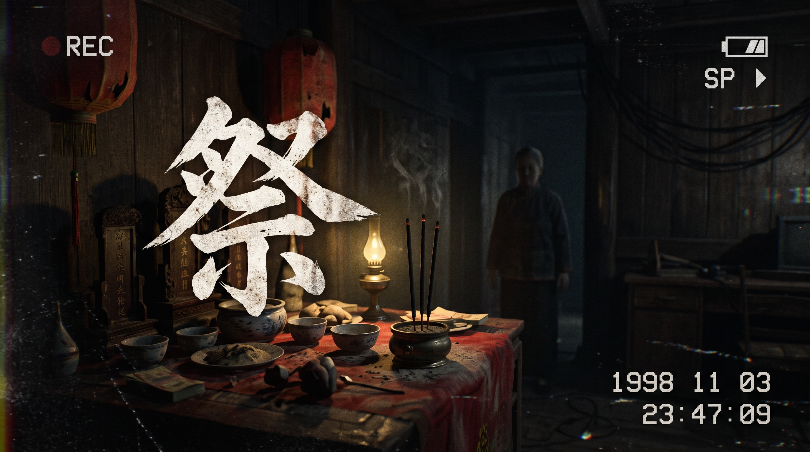

# 祭：她在画面里
### SHE IS IN THE FRAME

一款 **可离线游玩** 的 found-footage 心理恐怖 vertical slice。首次游玩模拟中位 **9 分 38 秒**（p10 8:53 / p90 10:42）；目标 10–15 分钟，第二幕「暗房」已收入。  
真等距像素房间 × 第一人称 DV 素材 × 一次对“谁在拍”的追问。



> **GitHub**：<https://github.com/foxmuldery/ji-she-in-frame>  
> **下载 / Release**：<https://github.com/foxmuldery/ji-she-in-frame/releases>  · 当前版本见 [`VERSION`](VERSION)  
> **交接报告**：[`HANDOVER_FINAL.md`](HANDOVER_FINAL.md)（顶部为 v2.10.1 现状，正文 v2.8 历史快照）  
> **在线内测（需要试玩密码，带记录器）**：<https://foxmuldery.github.io/ji-she-in-frame/playtest/beta.html>  
> **试玩（内容扩充分支）**：[`TRIAL_PLAY.md`](TRIAL_PLAY.md) · 自检 `./dev/verify.sh`  
> **第三方评估（v2.8 历史快照，时长结论已被推翻）**：[`EVALUATION_HANDOVER.md`](EVALUATION_HANDOVER.md)

> 你以为你在扮演她。  
> 直到你举起摄影机。

---

## 在线内测 / 记录器

内测入口：<https://foxmuldery.github.io/ji-she-in-frame/playtest/beta.html>（GitHub Pages，`gh-pages` 分支，`noindex`）。

- **试玩密码**：入口、游戏、复盘页共用一个密码，由发布者单独告知；仓库里只有 PBKDF2 盐与校验块，没有密码明文。第一次进入任一页面会跳到 `playtest/unlock.html`，输对后本标签页记住密钥，直到关闭标签页。
- **加密方式**：`gh-pages` 是公开的，所以内测构建里 `game.js`、`playtest/beta.html`、`playtest/report.html` 以 AES-256-GCM 密文发布（`playtest/*.enc`），密钥由密码经 PBKDF2-SHA256（310k 轮）现算、只存在于 `sessionStorage`；`/game.js` 在线上直接 404。`./dev/beta_gate/gate_check.mjs` 用真实按键跑一遍“错密码拒绝 → 对密码启动 → 关掉会话重新上锁”；加 `--live` 则改为对已发布的 Pages 站点跑同一套断言（15/15）。

- **带记录器试玩**：`index.html?rec=1` — 右下角出现一个记录器，记录按键时间点、屏幕上出现过的每一句字幕与提示、章节/场景/进度、掉帧与报错；可选同时录屏 + 麦克风（`getDisplayMedia`，仅本地保存，不上传）。
- **导出**：一局结束自动下载 `ji-playtest_<session>.json`；录屏在停止时保存为 `.webm`。中途刷新也不会丢（`localStorage` 保险）。
- **复盘**：`playtest/report.html` 拖入 JSON，看时长/分章/停顿/卡顿/字幕停留时间，一键复制 Markdown。
- **发布**：`./dev/deploy_beta.sh`（`--dry-run` 只构建）。脚本把运行时文件 + `playtest/` 拷到 `.beta-site/`，再由 `dev/beta_gate/build_gate.mjs` 封成密文并改写 `index.html`，然后推送到 `gh-pages`；不碰 `main`、不改版本号、不含 `dev/` 与生成源。密码从 `$BETA_PASS` 或 `dev/.beta_pass`（已 gitignore）读取。
- **不进发布包**：`playtest/` 与记录器是内测工具，`dev/package.sh` 的发布 zip 不含它们。

## 一句话

她跟男友回乡驱邪。村里人说，二十年一次的大祭，只求风调雨顺。  
你跟着她走进房间，举起摄影机——然后发现，画面里一直有她。

## 关于

《祭：她在画面里》改编自一部 40 分钟的 found-footage 恐怖短片。  
这个版本是一个 **可完整游玩的 vertical slice**：一间曾家村的老屋、一位坐在供桌后的老妇、一盘标着“旧带 1999”的 DV 素材，以及 23 分 06 秒的空白。

游戏在两种画面之间切换：

- **第三人称**：480×270 的真等距像素房间。你操控谢雨洁走动、互动、靠近她。
- **第一人称**：举起 DV 后，画面切到 4:3 的旧带素材。像素房间退成背景，老妇的脸占满取景器。

两种画面不是滤镜切换，而是两个叙事层：一个是你以为你在玩的游戏，一个是徐英子留下的素材。

## 玩法循环：五遍

这不是一遍流程，是 P.T. 式的五遍循环。每一遍房间都会变，动词也会变。

1. **第一遍 · 供桌**：在等距房间里走，靠近老妇按 `E`，按住 `F` 举起 DV。放下后她回头了。
2. **看与对**：`R` 看旧带，`Tab` 看供桌记录；走到香炉、水碗、门框旁分别按 `F` 显影 1.2 秒，得到香三、水左、线高。按 `L` 可以拍照片，照片里会多一只手。用 `E` 摆供，站到供桌前按 `空格` 起仪。
3. **第二遍 · 找她**：起仪后房间重置，椅子上没有人。按 `F` 用取景器找她——她会在帘子后面、供桌下面或椅子后面。走到那个位置按 `E`。找到四次，她才站起来。
4. **第三遍 · 拍异常**：房间暗了，而且被改过：香 1、水右、线低。走到香炉/水碗/门框旁，按 `F` 看取景器里“本来该是什么样”，按 `L` 拍下不对的地方。三处拍完后，须 `R` 回看并在带子里用 `A`/`D` 停在 **闭眼那一帧**，再进入下一遍。
5. **第四遍 · 躲她**：她站起来了。按 `F` 看她正看着哪个藏点；放下 DV，在倒计时内躲到另外两个地方之一，按 `E`。她看着的一侧偶尔会假响动——别上当。躲错/超时会重来当前轮。躲开 4 轮。
6. **最后一遍 · 拍她 / 电话**：她还站着。走近按 `F`、`L` 拍下；电话响了，走到门口按 `E` 进入走廊。走廊里 `F` 是另一台 DV：路过侧门、遗像、门牌时按住它看清（**看清门牌前电话不会接**），走到尽头按 `E` 接电话。
7. **第二幕 · 暗房**：电话挂了，尽头的门自己开一条缝。门后是徐英子的剪片室：按住 `F` 在红灯下显影三处——洗印线上六张都看着镜头、剪辑台上被剪断的带子、放大机打在墙上的空画面。回到台前按 `E` 夹住两端，`Q`/`E` 把断口对到红线上、`空格` 接带；那 23 分钟跑起来，画面里她先回头，摄影机才跟上。按 `L` 把这一格洗成照片，再按 `E` 推门回去。回来后她才坐回椅子；按 `Q` 让她抬手，再举起 DV——取景器里是另一只手。
8. **回看 23:06**：`R` 回看，`A/D` 倒带。到空白段先按 `1/2/3` 校验三件事：哪一年的带、23:06 缺了哪一帧、走廊门牌上是谁的名字；答对后才解锁「重建」条，拖它对齐 23:06；`P` 分屏对照。
9. **结局**：走向她，或继续拍。两个主结局 + 一个三次摆错的坏结局。

实测时长（`index.html?naive=100&pace=human`，零知识玩家，只读屏幕文字）：

| 口径 | p10 | 中位 | p90 |
| --- | --- | --- | --- |
| 首次游玩（含读字幕停顿） | 8:53 | **9:38** | 10:42 |
| 熟练速通（不读、最优路径） | — | 约 6:30 | — |

分章中位：第一遍 3:54 · 第二遍 0:55 · 第三遍 1:18 · 第四遍 1:04 · 第五遍+走廊+暗房 1:34 · 回看与结局 1:00。  
目标 10–15 分钟：**中位 9:38、p90 10:42，已进入 10 分钟档；第二幕「暗房」为 v2.10 新增**。

## 恐怖点

这不是 jump scare 合集。它靠“看错 / 被看 / 多一个人 / 少一段”慢慢收紧：

- **被看**：第一次举起 DV，取景器里是谢雨洁；放下后她回头了。左上角「拍摄者：徐英子」不是装饰。
- **看错**：你让她抬手，再举起 DV——取景器里是另一只手。你拍到的，不是你看见的。
- **多一个人**：三样供摆对后，黑场一秒。灯再亮时，椅子上的人还在，但有人站在你身后。
- **少一段**：旧带 18:06 之后是 23 分 06 秒的空白；重建条补上的，是徐英子的记忆。
- **多一双眼睛**：每次按 R 回看，暗处会多一对眼睛；第二次退出回看，会听见“别回头”。
- **带子与实物对不上**：第一遍的“供桌原样”和炉孔/水痕/绳痕矛盾；摆错后卡片会变成「这一页不对 / 带子在骗你」。这是本作的核心揭秘点。
- **取景器里多一个人**：显影 1.2 秒完成，供桌旁会浮出一张老妇的脸；盯太久（2.8 秒），她更近。摄像机看到的东西，房间里没有。
- **照片里多一只手**：按 L 快门后，画面边缘会伸进一只不属于任何人的手；拍齐三张，她会在你放下 DV 后站到你身后。
- **时间的错**：旧带 1999、key art 1998、游戏内 2003；第二次回看第 5 帧，老妇的乳白盲眼会闭上。

没有血腥特写；惊吓主要来自声音、停顿和画面里多出来的东西。暂停菜单可切换「闪烁效果：柔和」。


## 特色

- **真等距像素场景**：12×9 网格、2:1 地砖、自由行走与碰撞；烛光、窗光、香火、雾气都用像素点阵与抖动（dither）绘制。
- **双层叙事画面**：第三人称像素重建 / 第一人称旧带 DV。举起与放下摄影机，是游戏唯一的“攻击键”。
- **P.T. 式五遍**：供桌 → 找她 → 拍异常 → 躲她 → 手。每遍房间重置、规则改变，不是同一谜题重复。
- **取景器显影**：站到香炉/水碗/门框旁分别按 `F` 显影 1.2 秒；每次只显出一个真相。松开回到房间，现实仍是另一套。摄像机是主观察工具，不是过场。
- **回看校验**：23:06 空白段要先选对磁带年份（1999）和缺失帧（白胶布的手），答错会跳带，答对才能拖重建条。
- **最后拍她 / 电话**：第五遍她还站着；拍她一张后电话响，走到门后走廊尽头接电话，回来才解锁 `Q`。
- **第二幕 · 暗房**：电话之后还有一间房。红灯显影、六张洗印、断成两截的 23 分钟、一台接带器与一架放大机；接带要对齐断口，接上后才看得到她先回头。整段不设失败，只设「看清」。
- **躲她 / 倒计时**：第四遍她站在房间里，取景器显示她的视线；12 秒内躲到另外两个藏点之一。躲错/超时黑场重来，躲开 3 轮。
- **快门 / 照片**：显影时按 `L` 拍一张，耗 16% 电；照片里会多出一只手。拍齐三张，放下 DV 时她会站在你身后。
- **照片结局**：集齐三张照片后，主结局会多一句“站在你身后的人，是徐英子”。
- **不可靠的旧带**：18:06 的“供桌原样”可能是假的。实物（炉孔、水痕、绳痕）和取景器给出另一套；你可以选择信哪一个。
- **供桌记录 / Tab**：把旧带、实物线索、三种候选摆法摊在同一张记录上；当前摆法和第几遍一眼可见。
- **三遍仪轨 / 起仪**：`E` 调整香炉、水碗、红绳，`空格` 起仪。摆错会进入下一遍：灯灭、眼睛变多、带子损坏；三次都错触发坏结局。
- **回看与重建**：暂停、倒带、逐帧。你可以在 23:06 的空白里拖动“重建条”，把徐英子补上的那一段对齐。
- **不靠 jump scare 堆砌**：靠视线、声音、日期对不上、和一张多出来的脸；真正的惊吓来自“带子不可信”。
- **完整的声音层**：环境床、雨、灯丝、钟摆、水滴、门轴、脚步、呼吸、老妇的四句普通话台词，以及 90 秒氛围音乐。
- **为展示而做的外壳**：标题页、制作名单、暂停菜单、全屏、静音、闪烁效果开关、内容提示。
- **总用时**：暂停菜单与结局显示本次用时、章节时间记录，方便试玩计时。
- **离线单包**：解压后双击 `index.html` 即可；不需要安装、不需要联网、不需要构建。

## 玩之前

- **目标时长**：10–15 分钟；模拟首次游玩中位 **9:38**，真人摸索通常还会更慢。见 [`TRIAL_PLAY.md`](TRIAL_PLAY.md)。
- **内容提示**：尸体、血迹、惊悚暗示、突然的音效、磁带闪烁与跟踪带；无血腥特写。
- **耳机建议**：声音设计占体验的一半。
- **闪烁敏感**：暂停菜单里有「闪烁效果：柔和」，会关闭磁带滚动、降低 CRT 扫描线与 glitch 跳帧；系统开启“减少动态效果”时也会自动使用柔和档。
- **浏览器**：Chrome / Edge / Safari 桌面版。游戏按 `file://` 离线运行设计；若你的浏览器阻止本地媒体自动播放，点一下画面或按任意键即可。

## 操作

| 操作 | 键位 |
| --- | --- |
| 移动 | `W` `A` `S` `D` / 方向键 |
| 互动 / 调整供桌 | `E` |
| 快门 / 照片 | `L` |
| 起仪 | `空格` |
| 举起 / 放下 DV | 按住 `F` 或鼠标右键 |
| 回看 | `R` |
| 让她抬手 | `Q` |
| 回看倒带 / 逐帧 | `A` / `D` |
| 回看重建微调 | `Q` / `E` |
| 重建分屏 | `P` |
| 暂停 / 继续 | `Esc` |
| 静音 | `M` |
| 供桌记录 | `Tab` |
| 结局卡：重开 / 名单 / 标题 | `Enter` / `C` / `Esc` |
| 标题页：开始 | `Enter` / `空格` |

## 画面

<table>
<tr>
<td></td>
<td></td>
</tr>
<tr>
<td></td>
<td></td>
</tr>
<tr>
<td></td>
<td></td>
</tr>
<tr>
<td></td>
<td></td>
</tr>
<tr>
<td></td>
<td></td>
</tr>
<tr>
<td></td>
<td></td>
</tr>
<tr>
<td></td>
<td></td>
</tr>
<tr>
<td></td>
<td></td>
</tr>
<tr>
<td></td>
<td></td>
</tr>
<tr>
<td></td>
<td></td>
</tr>
<tr>
<td></td>
<td></td>
</tr>
<tr>
<td></td>
<td></td>
</tr>

</table>

更多截图与商店素材在 [`store/`](store/)。

## 运行

1. 解压整个文件夹（不要只拖 `index.html` 出来，素材在 `assets/`）。
2. 双击 `index.html`，或拖进浏览器。
3. 允许声音；按「开始」。

也可以用本地静态服务器：

```bash
cd ji_third_person_demo
python3 -m http.server 8000
# 打开 http://localhost:8000
```

> 游戏本身不依赖服务器；`file://` 是目标运行方式。  
> 若使用服务器，请不要把 `assets/audio/` 之外的开发文件一起部署。

## 这一版包含

- 完整流程：开场 → 靠近老妇 → 举起 DV → 第一次回看 → 她回头 → 看旧带/摆「三样供」→ 起仪 → 让她抬手 → 错手 → 第二次回看 → 两个主结局（摆错三次则坏结局）。
- 两个主结局：「你走过去了。」/「你一直在拍她。」；三次摆错则进入坏结局「她替你摆好了。」
- 标题页、制作名单、暂停菜单、全屏、静音、闪烁效果开关。
- 34 个本地音频文件、5 秒 DV 素材、1 张关键美术、若干像素参考图。
- 57 项自测、34 个音频、3 档 UI 版式审计、3 个真实按键结局全部通过（`./dev/verify.sh` 一条命令）。
- `dev/sim.sh` 模拟玩家批量试玩（默认 1000 次），用于压测流程与统计时长。

## 这一版不包含

- 正式实拍素材：当前 DV clip、关键美术、老妇四视图与部分参考图由 **MiniMax Design** 生成，是占位/风格参考，不是最终电影镜头。
- 完整 40 分钟章节、存档、多语言、手柄支持。
- 商业发行所需的最终版权清理（音乐、字体、实拍素材）。

## 技术

- HTML5 Canvas 2D + 原生 JavaScript / CSS / WebAudio；无框架、无 ES modules、无构建步骤。
- 像素画布 480×270；DV 画布 1280×960（内部 640×480 像素场景）；16:9 舞台内嵌 4:3 素材。
- 摄像机层支持三种状态：本地 MP4 实时素材 → 同一卷带的静帧 poster（解码等待/自动播放被阻止时）→ 程序化像素 fallback。
- RetroZone ShaderOverlay（MIT）用于像素摄像机与回看的 CRT；实时视频层使用 CSS CRT，避免 `file://` 视频污染 WebGL 画布。
- 所有音频用 `<audio>` 元素播放，避免 `file://` 下 `decodeAudioData` 的 CORS 限制。
- 音频已从 WAV 转为 MP3（循环床与雨声保留 WAV 以保证无缝循环）；关键美术从 PNG 转为高质量 JPEG。运行音频约 10 MB，zip 约 13 MB。
- 2026-10-22 音频重交付：28 个音乐 / 环境 / 拟音 / 配音文件换成 192 kbps 新母带（见 `assets/audio/AUDIO_ASSET_DELIVERY_REPORT.md`）。新母带留了 3–17 dB 余量，接入时按 `dev/audio/delivery_gains.tsv` 逐文件补增益，峰值回到原调音电平，游戏内 volume 表无需改动。

## 制作与素材声明

- **概念 / 剧本**：改编自 40 分钟 found-footage《祭》。
- **像素美术 / 场景 / 代码**：程序化 Canvas 2D 绘制；本原型由 DeepSeek Harness 协作完成。
- **图像 / 声音 / 音乐 / 视频占位资产**：MiniMax Design 桌面端生成（`nano_banana` / `seedaudio` / `minimax_music` / `minimax_tts` / `minimax_v3`）。
- **老妇普通话台词**：MiniMax TTS，`Chinese (Mandarin)_Kind-hearted_Elder` / `speech-2.8-hd`。
- **CRT 着色器**：RetroZone ShaderOverlay，MIT，见 [`vendor/retrozone-LICENSE.txt`](vendor/retrozone-LICENSE.txt)。
- **字体**：系统字体（Songti SC / PingFang SC / Courier New），无外部字体文件。

本作为非商业原型；占位资产不构成最终发行素材。若用于商业发行，请替换为实拍/手绘素材并完成相应授权。

## 版本

当前：**v2.10.1**（见 [`VERSION`](VERSION)）。

**v2.10.1 · 大屏可读性 / 内测加密 / 商店预告（2026-10-22）**

- HUD 随舞台等比缩放：`--u` 由 `#stage` 高度算出（720p 参考，上限 2.25×），1080p / 1440p 下字幕、章节目标、记录板不再缩成脚注；`?uitest=1` 入闸扩到 1366×768 / 1920×1080 / 2560×1440 共六档。
- 新增可读性审计 `?nointro=1&lumtest=1`：逐帧量暗房三处显影、接带面板、走廊三处观察、字幕底板的亮度与局部对比（含 55% 显示增益的“暗屏笔记本”模拟），23/23 通过并入 `dev/verify.sh`。
- 按审计结果调光：走廊整体提亮约一档（墙面 / 地面 / 门框 / 灯光池），暗房剪辑台加工作灯光池；三个显影点仍保持“暗房”，只是不再黑成一块。
- 内测构建改为密文发布：AES-256-GCM + PBKDF2（310k），`/game.js` 线上 404，`playtest/unlock.html` 统一解锁，`dev/beta_gate/gate_check.mjs` 15/15 真实按键验证。
- 新增商店预告片：`./dev/trailer/run.mjs` 用真实渲染器逐帧画 26 秒（标题 → 房间 → DV → 回看断带 → 走廊 → 暗房 → 落版），`MediaRecorder` 回传 + `ffmpeg` 混音出 `store/trailer_26s.mp4`（1280×720 / 30 fps / H.264 + AAC）与 `store/cover_1280x720.jpg`。
- 新增 `./dev/store_shots.sh`：走廊 / 暗房 / 接带 / 出口四张商店截图改为可复现的确定性截屏，重跑即与当前构建一致。

**v2.10 · 第二幕「暗房」（2026-10-22）**

- 新增第二幕：接完电话后，走廊尽头的门自己开一条缝。门后是徐英子的暗房剪片室，一套独立的第一人称场景（红灯、洗印线、剪辑台、放大机、药水盘）。
- 三处「红灯显影」：洗印线上六张照片、被剪断的 23 分钟、放大机打在墙上的空画面；三处都看清后，剪辑台才让你动剪子。
- 新增接带操作：`Q` / `E` 移动带子，把断口对到红线，`空格` 接带；对不上只会弹带重来，不会卡死。接上后跑出那 23 分钟——「她先回头，摄影机才跟上」，正面解释两个结局。
- 新增洗印动作：`L` 把接好的一格洗成照片（照片里站着两个人），非必做，不拍照也能推门离开。
- 章节面板新增暗房状态（显影 N/3、接缝偏移 ±%、照片已拍/未拍），提示与字幕沿用按字数计算的停留时间。
- 模拟与回归：自测 57 → 72（新增暗房进入、三处显影、接带失败不锁死、接带成功、洗印、门口退出、回到房间 13 项），`dev/sim/naive_sim.js` 学会整套暗房流程。
- 时长：零知识人速模拟 100 局 100% 通关，中位 8:24 → **9:38**（p10 8:53 / p90 10:42），第二幕贡献约 +74 秒。
- 发布包：`dist/ji-she-in-frame-v2.10.1.zip`

**v2.9 · content & gate（2026-10-22）**

- 走廊有了自己的 DV：`F` 举起后能看清侧门里的另一把椅子、缺了一张脸的遗像、以及门牌上的名字；**不看门牌，电话不会接**，把“走到底按 E”变成一次观察。
- 第二遍找她 3 → 4 次，第四遍躲她 3 → 4 轮，并配上对应的报数文案。
- 回看校验加了第三题（走廊门牌的名字），让走廊的观察在结局前得到回收。
- 字幕停留时间按字数计算（`readingTime`），长句不再在读完前消失。
- 取证 / 回归：新增 `dev/e2e/run.sh` —— 三个结局各跑一遍**真实按键**全流程，只读屏上文字判定结局卡，接入 `./dev/verify.sh`。
- UI 版式审计：新增 `?nointro=1&uitest=1`（`dev/verify.sh` 内置 1280×720 / 1024×768 / 800×480 三档）——把游戏里最长的中文串推进每个 HUD 槽位，检查字幕、提示、章节目标、记录板、回看条、暂停 / 名单 / 结局卡是否被 `#stage` 裁切或超出画外，并验证暂停按钮不重叠、点击区 ≥80×30。矮窗口下暂停改两列、控制说明收起、标题与结局卡压缩，避免够不到「继续」。
- 键鼠同等：结局卡与标题页支持纯键盘操作（`Enter` 重开 / `C` 名单 / `Esc` 回标题），按钮补 `:focus-visible` 描边。
- 零知识模拟新增 `?pace=human`（按字幕长度停顿），100 局 100% 通关，中位 8:24（2026-10-22 复测）。
- 发布脚本 `dev/package.sh`：只打运行时文件，输出 `dist/ji-she-in-frame-v2.10.1.zip` + SHA-256；包内 `?test=1` / `?audiodbg=1` 均通过。
- 发布审计 `dev/release_audit.mjs`（`verify.sh` 末尾自动跑）：版本号四处一致、zip 比源码新且含当前 `game.js`、zip 不含开发/生成源/内测钩子、**每个随包素材都能在 MANIFEST / CREDITS / RIGHTS 找到出处**、校验和匹配、预告片规格合规。

**v2.8 · audit hotfix（2026-10-21）**

- 新增「三样供」仪轨：`R` 看旧带 18:06 的供桌提示，回到房间用 `E` 调整香炉/水碗/红绳，HUD「仪轨」逐项确认；完成后才解锁抬手。
- 新增「取景器显影」：显影目标绑定站位——香炉旁显香三、水碗旁显水左、门框旁显线高；每次 1.2 秒，2.8 秒后取景器里多一个人。
- 新增 DV 电量：拍摄与显影耗电，松开缓慢回充；电尽镜头自动熄灭。
- 新增 P.T. 式五遍：供桌 → 找她 → 拍异常 → 躲她 → 手；后三遍会重置房间、藏起老妇、改变动词。
- 审计修复：移动锁、电量/躲她更新、回看答案、重开串局、按键连发、脸部画布污染、走廊输入等。
- 新增本次用时：暂停与结局显示总时长，章节切换记录章节时间。
- 新增门后走廊：拍她后电话响，走到门口按 E，W 前进到尽头接电话；电话里说“别让她抬手”。
- 新增回看校验：23:06 空白段按 1/2/3 选磁带年份和缺失帧，答错跳带，答对才解锁重建条。
- 新增第五遍「先拍她」：她还站着，按 L 拍下后才坐下并解锁 Q。
- 新增第四遍「躲她」：她站在房间里，取景器报视线方向，12 秒内躲到另外两个藏点之一；躲错/超时重来当前轮。
- 第三遍改为「拍异常」：房间被改成香1/水右/线低，取景器显示原本的香三/水左/线高，玩家拍下三处不对。
- 新增快门/照片：显影时按 `L` 拍一张，耗 16% 电；照片里多一只手。拍齐三张触发站立人影，并改写主结局最后一句。
- 新增「供桌记录」Tab 案板：旧带 / 实物 / 候选 / 当前摆法 / 第几遍。
- 新增「三遍带」循环：带子给出一套“供桌原样”，房间实物给出另一套；站到供桌前按 `空格` 起仪。
- 摆错进入下一遍：灯灭、眼睛变多、带子损坏成「这一页不对」；三次都错触发坏结局「她替你摆好了。」
- 新增恐怖节拍：仪轨完成后黑场 + 站立人影；每次回看暗处多一对眼睛；第二次退出回看触发“别回头”低语。
- 新增低频心跳/呼吸、黑场、站立老妇像素剪影与恐怖段落文案。
- 新增旧带提示卡、动态香炉/水碗/红绳状态与提示音。
- 新增标题页按钮组、制作名单、暂停菜单、全屏、闪烁效果开关。
- 新增 DV 静帧 poster 过渡：解码等待时不再闪回像素 fallback。
- 统一色调与光比：窗光体积、地面积水、供桌暖光、悬挂外套细节。
- 音频 WAV → MP3，关键美术 PNG → JPEG；发布 zip 约 13 MB。
- 46/46 自测通过；24/24 音频加载通过。（v2.7 数据；v2.9 为 57/57、34/34、UI 3/3、e2e 3/3。）
- 发布包：`dist/ji-she-in-frame-v2.10.1.zip`
- SHA-256：见 `dist/ji-she-in-frame-v2.10.1.zip.sha256`（打包时生成；避免把校验值写进包内 README 造成自指）

上架前的人工确认与商业发行替换项见 [`RELEASE_CHECKLIST.md`](RELEASE_CHECKLIST.md)。

开发过程、调试参数与历史截图见 [`DEVLOG.md`](DEVLOG.md)。

## 文件

```
index.html              入口
style.css               舞台、HUD、标题/暂停/名单、CRT
game.js                 游戏、像素场景、DV、回看、音频、自测
assets/audio/           运行音频（MP3 / 循环 WAV）
assets/poster_data.js   DV 静帧数据 URI（保持画布不污染 WebGL）
assets/video/           5s DV 素材
assets/images/          关键美术、poster
assets/references/v2/   老妇面部、等距参考（运行时只用 480 版）
vendor/                 RetroZone CRT
store/                  商店页文案、封面、截图
shots/                  开发截图
DEVLOG.md               开发记录
RELEASE_CHECKLIST.md    上架前检查 / 商业发行替换项
```

---

**祭 · 曾家村 · 2003.08.17**  
*她 在 画 面 里*
